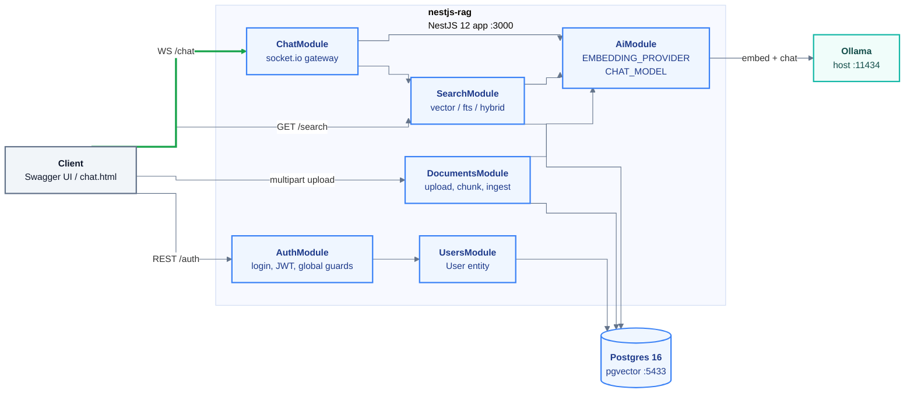
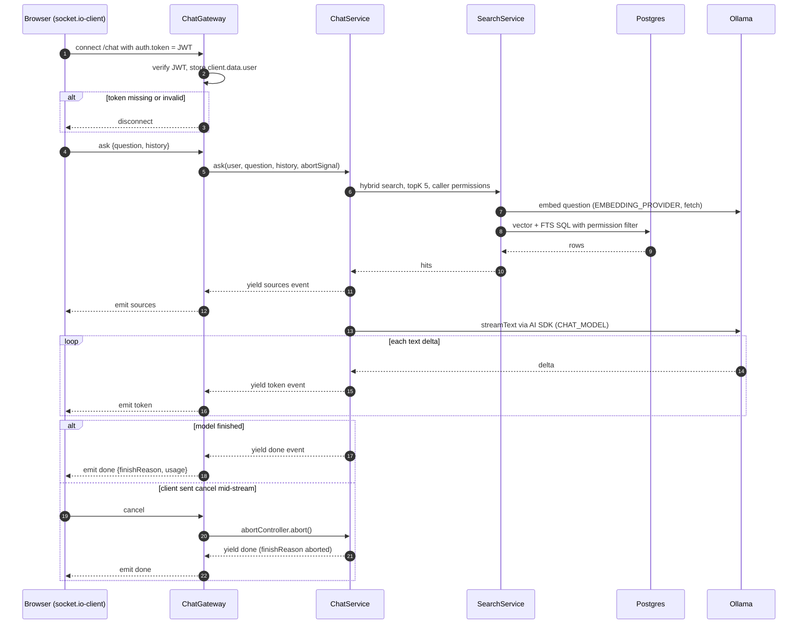

# nestjs-rag - Design Spec

- **Date:** 2026-10-14
- **Status:** approved in conversation (5 sections), waiting for written-spec review
- **Location:** `D:\project\nestjs-rag`
- **Sibling reference:** `D:\project-fpt\springboot-rag` (Java, Spring Boot 3.5) - the domain this project borrows

---

## 1. Purpose

A self-study sandbox to **learn NestJS**. Retrieval-augmented generation (RAG) is the vehicle, not the goal.
There is no feature parity target with springboot-rag.

Secondary goal: see how the Node AI tooling differs from the Java side (hand-written retrieval in both,
plus the Vercel AI SDK here, which has no direct Java equivalent in the sibling project).

Audience for the knowledge: a mix of job market (mainstream Nest stack that shows on a CV) and personal
skill (pick what teaches most where there is no mainstream answer).

### 1.1 What the user said vs what was assumed

| Said by the user | Assumed, accepted in review |
|---|---|
| Learn NestJS mainly; RAG is the vehicle | Sandbox, not production |
| Has Express experience | Local stack only, no paid API |
| Mix of job-market and personal learning | TypeScript strict |
| ORM + migrations, with **TypeORM** | Approach A: feature-sliced app (not a concept tour, not a monorepo) |
| JWT auth + roles | Explicit transaction boundaries (user's standing preference) |
| Real-time streaming | No queues, no Redis |
| AI layer = "Mix": hand-written retrieval SQL + Vercel AI SDK for chat and tools | Node 22.14 (installed); Node 24.11+ allowed later |
| Project lives under `D:\project`, not `D:\project-fpt` | |

### 1.2 Success criteria

1. Every concept in the **concept map (section 5)** is used in the app for a real reason, and
   `docs/implementation-notes.md` says why it is there.
2. The user can explain, from this code: the Nest request pipeline order, how a dynamic module is built,
   why an injection token is needed for an interface, and how WebSocket auth differs from HTTP auth.
3. All six build phases (section 11) end with the app running and `npm test` green.
4. A private document of user B **never** appears in user A's search results, compare results, or chat
   sources - proven by e2e tests, not assumed.

---

## 2. Stack (versions checked on npm, 2026-10-14)

| Area | Choice | Version seen | Why |
|---|---|---|---|
| Runtime | Node | 22.14 installed | meets every engine below |
| Framework | NestJS, **ESM project** | `@nestjs/core` 12.1.3, CLI 12.0.8 | Nest 12 ships ESM; `nest new` asks CJS or ESM |
| Language | TypeScript strict | 6.x (CLI pins `~6.0.2`) | required by Nest 12 schematics |
| Test runner | **Vitest** (Nest 12 default for new projects) | - | what new Nest codebases use |
| Lint / bundler | oxlint, Rspack (Nest 12 defaults) | - | keep defaults, no fight |
| ORM | **TypeORM 1.x** + `@nestjs/typeorm` | 1.1.2 / 12.0.2 | user choice; native `vector` / `halfvec` column types for pgvector |
| DB driver | `pg` | 8.23.1 | |
| Auth | `@nestjs/jwt`, `@nestjs/passport`, `passport`, `passport-jwt`, `bcryptjs` | 12.0.3 / 12.0.0 / - / 4.0.1 / - | mainstream; `bcryptjs` is pure JS, avoids native build on Windows |
| Validation | `class-validator`, `class-transformer` | 0.15.1 / - | mainstream DTO style |
| Schemas | `zod` | - | needed by AI SDK tool schemas; also used for env validation |
| Real-time | `@nestjs/websockets`, `@nestjs/platform-socket.io` | 12.1.3 | |
| AI | `ai` (Vercel AI SDK 7), `ai-sdk-ollama` | 7.0.139 / 4.5.0 | AI SDK 7 is ESM-only, Node >= 22 |
| Docs | `@nestjs/swagger` (CLI plugin) | 12.0.2 | |
| Static page | `@nestjs/serve-static` | - | serves `public/chat.html` only |
| Dev | `@testcontainers/postgresql`, `supertest`, `socket.io-client`, `@types/*` | 12.2.1 / - | |

Versions marked `-` were not checked yet; they are resolved at install time. **No package is installed
without the user's OK on the list** (user rule). `passport-local` is left out on purpose: login is a plain
controller plus `JwtService`.

`package.json` sets `"engines": { "node": ">=22.13" }`. TypeORM's engine range skips Node 24.0-24.10,
so a later move to Node 24 must be 24.11+.

---

## 3. Infrastructure

Own `docker-compose.yml`, independent of springboot-rag:

| Service | Image | Host port | Notes |
|---|---|---|---|
| Postgres | `pgvector/pgvector:pg16` | **5433** | DB `nestrag`; Java keeps 5432 |
| Ollama | not in compose | 11434 | reuse the host Ollama |

Models: `nomic-embed-text` (768 dims) for embeddings, `qwen3:8b` for chat. Both come from config.
No Qdrant, no Redis, no reranker.

### 3.1 Configuration (`.env`, validated with zod at boot, fail fast)

| Key | Default in `.env.example` | Notes |
|---|---|---|
| `PORT` | `3000` | |
| `DB_HOST` / `DB_PORT` / `DB_USER` / `DB_PASSWORD` / `DB_NAME` | `localhost` / `5433` / `rag` / `rag` / `nestrag` | |
| `JWT_SECRET` | (none, required) | min 32 chars, checked by zod |
| `JWT_TTL_SECONDS` | `3600` | number of seconds (see section 15) |
| `OLLAMA_BASE_URL` | `http://localhost:11434` | |
| `EMBEDDING_MODEL` / `EMBEDDING_DIM` | `nomic-embed-text` / `768` | dim must match the migration |
| `CHAT_MODEL` | `qwen3:8b` | |
| `CHAT_THINK` | `true` | send Ollama `think`; set `false` for a non-reasoning model |
| `UPLOAD_MAX_BYTES` | `1048576` | 1 MB |
| `ADMIN_EMAIL` / `ADMIN_PASSWORD` | (empty) | optional admin seed, see 7.1 |

Config is read through `@nestjs/config` `registerAs` namespaces: `db`, `auth`, `ai`, `upload`.
`.env` is gitignored; `.env.example` is committed.

`synchronize: false` always. The schema changes only through hand-written TypeORM migrations. The app runs
pending migrations at boot (`migrationsRun: true`); the TypeORM CLI runs against the compiled
`dist/database/data-source.js` (see section 15).

---

## 4. Architecture

### 4.1 Module topology



The global `JwtAuthGuard` and `RolesGuard` from `AuthModule` run in front of **every** HTTP route; that is
registration through `APP_GUARD`, not a module dependency, so it is not drawn as an edge.

> VS Code note: the local Markdown Preview Mermaid extension shows a blank box for diagrams with an
> `%%{init}%%` block. The diagram renders correctly on GitHub and with `mmdc` (verified).

### 4.2 Modules

| Module | Holds | Exports |
|---|---|---|
| `AppModule` | root: `ConfigModule`, `TypeOrmModule.forRootAsync`, global guards / filter / interceptor via `APP_*` tokens, `RequestIdMiddleware` | - |
| `UsersModule` | `User` entity, `UsersService` | `UsersService` |
| `AuthModule` | `AuthController`, `AuthService`, `JwtStrategy`, `JwtAuthGuard`, `RolesGuard`, decorators, admin seed | guards |
| `AiModule` | dynamic module (`forRootAsync`, built with `ConfigurableModuleBuilder`, registered once in `AppModule` as global); `EMBEDDING_PROVIDER`, `CHAT_MODEL` | both tokens |
| `DocumentsModule` | `Document`, `Chunk` entities, `DocumentsController`, `DocumentsService`, `Chunker`; `documents/visibility.ts` holds `canRead()` and the matching SQL fragment | - |
| `SearchModule` | `SearchController`, `SearchService`, `SearchRepository` (raw SQL), `rrf()` | `SearchService` |
| `ChatModule` | `ChatGateway`, `ChatService`, prompt builder, agent tool | - |
| `common/` (not a module) | middleware, interceptor, filters, shared decorators | - |

No circular module imports. If one appears, that is a design smell to fix, not a `forwardRef` to add.

### 4.3 Directory layout

```
nestjs-rag/
  docker-compose.yml
  .env.example
  public/chat.html                      # static chat test page (vanilla JS + socket.io client)
  src/
    main.ts
    app.module.ts
    config/                             # env.schema.ts (zod), *.config.ts (registerAs)
    database/                           # data-source.ts (CLI), migrations/
    common/
      middleware/request-id.middleware.ts
      interceptors/timing.interceptor.ts
      filters/typeorm-exception.filter.ts
      filters/ws-exception.filter.ts
    users/
    auth/                               # decorators/, guards/, strategies/, dto/
    ai/                                 # ai.module.ts, ai.module-definition.ts, embedding/, chat-model.provider.ts
    documents/                          # entities/, chunker.ts, documents.service.ts, documents.controller.ts, dto/
    search/                             # search.repository.ts, rrf.ts, search.service.ts, search.controller.ts, dto/
    chat/                               # chat.gateway.ts, chat.service.ts, prompt.ts, chat-events.ts, agent-tools.ts
  test/
    support/                            # global-setup.ts (Testcontainers), fake-embedding.provider.ts, app factory
    e2e/
  docs/
    superpowers/specs/  superpowers/plans/
    implementation-notes.md
```

---

## 5. Nest concept map (the success checklist)

| Concept | Where | The lesson |
|---|---|---|
| Module imports / exports | `UsersModule` -> `AuthModule`; `SearchModule` -> `ChatModule` | encapsulation; a provider is invisible outside its module unless exported |
| Injection token | `EMBEDDING_PROVIDER`, `CHAT_MODEL` | TS interfaces are erased at runtime; a token makes them injectable and swappable in tests |
| Dynamic module | `AiModule.forRootAsync()` via `ConfigurableModuleBuilder` | how `TypeOrmModule.forRootAsync` works inside |
| Middleware | `RequestIdMiddleware` (`x-request-id`, generated if missing) | runs before guards; has no handler context |
| Guards | global `JwtAuthGuard` + `@Public()`; global `RolesGuard` + `@Roles()`; WS handshake check | `Reflector` metadata, global guard order, HTTP guards do not cover WS connections |
| Interceptors | `TimingInterceptor` (`X-Response-Time` + log line); `FileInterceptor`; `ClassSerializerInterceptor` | RxJS around the handler |
| Pipes | global `ValidationPipe` (`whitelist`, `forbidNonWhitelisted`, `transform`); `ParseFilePipe`; `ParseUUIDPipe`; `ValidationPipe` on WS payloads | WS validation needs an exception factory that throws `WsException` |
| Exception filters | `AppExceptionFilter` (HTTP, maps TypeORM errors, 500 with `requestId`), `WsExceptionFilter` (emits `error` event) | filters are per transport |
| Custom decorators | `@CurrentUser()`, `@Public()`, `@Roles()`, `@Auth(...roles)` via `applyDecorators` | param decorators vs metadata decorators |
| Lifecycle hooks | `AiModule` `onModuleInit` (Ollama ping + dimension check, warn not crash); `onApplicationBootstrap` admin seed; `enableShutdownHooks` | startup must survive a missing Ollama (lesson from springboot-rag) |
| Gateway | `ChatGateway` | events, per-socket state, cancel via `AbortController` |
| Swagger | CLI plugin on DTOs, bearer auth | |
| Provider scope | everything singleton | `implementation-notes.md` explains why `REQUEST` scope bubbles up the dependency chain and costs per-request instantiation |
| Testing module | `Test.createTestingModule(...).overrideProvider(...)` | swap real providers for fakes at the token level |

Request pipeline order to learn and note: middleware -> guards -> interceptors (before) -> pipes ->
handler -> interceptors (after) -> exception filters.

---

## 6. Data model

All tables are created by migrations. Primary keys are `uuid` with `gen_random_uuid()` default.

### 6.1 `users`

| Column | Type | Notes |
|---|---|---|
| `id` | uuid PK | |
| `email` | text, unique | stored lowercase |
| `password_hash` | text | `bcryptjs`, cost 10; `@Exclude()` on the entity |
| `role` | enum `user` / `admin` | default `user` |
| `created_at` | timestamptz | default `now()` |

### 6.2 `documents`

| Column | Type | Notes |
|---|---|---|
| `id` | uuid PK | |
| `owner_id` | uuid FK -> `users.id`, `ON DELETE CASCADE` | |
| `title` | text | first `# ` heading of a markdown file, else the filename without extension |
| `filename` | text | |
| `visibility` | enum `private` / `public` | default `private` |
| `chunk_count` | int | |
| `created_at` | timestamptz | |

Unique `(owner_id, filename)`: uploading the same filename twice is a **409**, not a silent replace.

### 6.3 `chunks`

| Column | Type | Notes |
|---|---|---|
| `id` | uuid PK | |
| `document_id` | uuid FK -> `documents.id`, `ON DELETE CASCADE` | |
| `chunk_index` | int | unique with `document_id` |
| `heading_path` | text | e.g. `Setup > Docker` (empty for `.txt`) |
| `content` | text | |
| `embedding` | `vector(768)` | TypeORM `vector` column type |
| `tsv` | `tsvector` generated `ALWAYS AS (to_tsvector('english', content)) STORED` | |

Indexes: HNSW on `embedding` with `vector_cosine_ops`; GIN on `tsv`. The unique `(owner_id, filename)`
index also serves `owner_id` lookups, so there is no separate btree.
The first migration runs `CREATE EXTENSION IF NOT EXISTS vector`. Migrations are **hand-written SQL**: a
generator would not know the extension, the HNSW operator class, or the generated column details anyway.

---

## 7. API

### 7.1 Auth and users

| Method | Path | Access | Body / query | Result |
|---|---|---|---|---|
| POST | `/auth/register` | public | `{email, password}` (password min 8) | 201 user (no hash). Role is always `user`; a `role` field in the body is rejected by `forbidNonWhitelisted` |
| POST | `/auth/login` | public | `{email, password}` | 200 `{accessToken}`. JWT payload `{sub, role}`, expiry from config |
| GET | `/auth/me` | any user | - | current user |
| GET | `/users` | admin | - | all users (the route that exercises `RolesGuard`) |

Login returns the same `401 Invalid credentials` for an unknown email and a wrong password, and compares
against a dummy hash when the user does not exist, so timing does not reveal which emails exist.

Admin seed: on `onApplicationBootstrap`, if `ADMIN_EMAIL` and `ADMIN_PASSWORD` are set and no admin
exists, create one. No credentials live in any migration.

No refresh tokens (YAGNI, noted as stretch).

### 7.2 Documents

| Method | Path | Access | Body / query | Result |
|---|---|---|---|---|
| POST | `/documents` | any user | multipart `file` (`.md` / `.txt`, max `UPLOAD_MAX_BYTES`) + `visibility` | 201 `{id, title, chunkCount}` |
| GET | `/documents` | any user | - | visible documents: own + public; admin sees all |
| GET | `/documents/:id` | any user | `ParseUUIDPipe` | document + chunk list (index, heading path, first 200 chars) |
| DELETE | `/documents/:id` | owner or admin | | 204 |

**Visibility rule** (one function, `canRead(user, doc)`, used everywhere):
`doc.visibility = 'public' OR doc.owner_id = user.id OR user.role = 'admin'`.

**Not-found vs forbidden:**
- Document not readable by the caller -> **404** (do not reveal it exists).
- Document readable (public) but caller is not owner and not admin, on DELETE -> **403**.

### 7.3 Search

| Method | Path | Access | Query | Result |
|---|---|---|---|---|
| GET | `/search` | any user | `q` (1..500 chars), `mode` = `vector` / `fts` / `hybrid` (default `hybrid`), `topK` 1..50 (default 10) | `{mode, latencyMs, hits[]}` |
| GET | `/search/compare` | any user | `q`, `topK` | `{embedMs, results: {vector, fts, hybrid}}`, each `{latencyMs, hits[]}` |

Hit shape: `{chunkId, documentId, title, headingPath, snippet (first 300 chars), score, rank}`.

`/search/compare` embeds the query **once** and runs the three modes **one after another**, so each
latency is measured alone (parallel runs would share the DB and blur the numbers).

### 7.4 Chat over WebSocket (namespace `/chat`)

Connection: socket.io handshake `auth: { token: "<JWT>" }`, checked by socket.io namespace middleware
(registered in the gateway's `afterInit`). A missing or bad token never connects: the client gets
`connect_error` with message `Unauthorized`.

| Direction | Event | Payload |
|---|---|---|
| client -> server | `ask` | `{question: string (1..2000), history?: {role: 'user' \| 'assistant', content: string}[] (max 10), mode?: 'rag' \| 'agent'}` |
| client -> server | `cancel` | `{}` |
| server -> client | `sources` | `{items: {n, chunkId, documentId, title, headingPath}[]}` |
| server -> client | `token` | `{text}` |
| server -> client | `toolCall` | `{name, input}` (agent mode only) |
| server -> client | `done` | `{finishReason, usage?}`; `finishReason = 'aborted'` after cancel |
| server -> client | `error` | `{message, requestId?}` |

Rules:
- One generation per socket at a time. An `ask` while one is running gets `error {message: 'busy'}`.
- Disconnect aborts any running generation.
- The JWT is checked at connect only. A token that expires during a long-lived connection keeps working
  until disconnect - accepted limitation, written in the notes.
- History is held by the client (stateless server), same as springboot-rag.

---

## 8. Flows

### 8.1 Upload / ingest

1. `FileInterceptor` (memory storage, multer size limit -> 413) reads the file; `ParseFilePipe` with a custom `FileExtensionValidator` checks the type.
2. Decode as UTF-8 with `fatal: true`; invalid bytes -> 400.
3. `Chunker` splits the text:
   - markdown: split at headings `#`..`###`, `heading_path` = joined heading trail;
   - sections longer than 1500 chars are packed by paragraph up to 1500 chars;
   - a fenced code block is never split unless the block alone is over 1500 chars;
   - `.txt`: paragraphs packed up to 1500 chars, empty `heading_path`;
   - empty file or zero chunks -> 400.
4. Embed all chunks through `EMBEDDING_PROVIDER` (Ollama `/api/embed` accepts an array; batches of 32).
   **This happens before any transaction**, so no transaction stays open during slow network calls.
5. One explicit `dataSource.transaction(async (manager) => { ... })`: insert the document, insert its
   chunks. Any failure rolls back everything, so there are never documents without chunks.

### 8.2 Search

All three queries join `documents` and apply the visibility rule **in SQL** (never filter in TS after the
query, which would leak through `topK` counts and timing).

```sql
-- vector
SELECT c.id, c.document_id, d.title, c.heading_path, c.content,
       1 - (c.embedding <=> $1) AS score
FROM chunks c
JOIN documents d ON d.id = c.document_id
WHERE (d.visibility = 'public' OR d.owner_id = $2 OR $3)
ORDER BY c.embedding <=> $1
LIMIT $4;

-- fts
SELECT c.id, c.document_id, d.title, c.heading_path, c.content,
       ts_rank_cd(c.tsv, q) AS score
FROM chunks c
JOIN documents d ON d.id = c.document_id,
     websearch_to_tsquery('english', $1) q
WHERE c.tsv @@ q
  AND (d.visibility = 'public' OR d.owner_id = $2 OR $3)
ORDER BY score DESC
LIMIT $4;
```

`$3` is `true` for admins. Hybrid runs both with 50 candidates each and fuses them in TS with
Reciprocal Rank Fusion, `k = 60`: `score = sum(1 / (k + rank))`, then takes `topK`.

The SQL runs through `dataSource.query()` / QueryBuilder in `SearchRepository`. TypeORM has a `vector`
column type but no similarity-search API - that boundary is a lesson.

### 8.3 Chat (RAG mode)

`ChatService.ask()` returns an `AsyncIterable<ChatEvent>` and knows nothing about sockets.
`ChatGateway` maps each event to an `emit`. This keeps the service unit-testable and makes an SSE variant
(stretch) a new adapter, not a rewrite.



Prompt rules (carried from the springboot-rag injection drill):
- Context chunks are fenced and numbered `[1]..[n]`; the instructions say text inside the fence is data,
  not instructions.
- The model must cite `[n]` and must say it does not know when the context does not contain the answer.
- If search returns zero hits, skip the LLM call: emit empty `sources`, a fixed "no visible documents
  match" token, and `done`.

qwen3 is a reasoning model. `ChatService` reads `fullStream` and forwards **text** parts only; reasoning
parts are dropped (and counted in the log). How `ai-sdk-ollama` exposes reasoning is checked in phase 5.

### 8.4 Chat (agent mode)

`mode: 'agent'` calls `streamText` with one tool, `searchDocuments`:
- input schema (zod): `{ query: string }`;
- `execute` calls `SearchService` hybrid search, topK 5, **with the caller's permissions** (the user is
  captured in a closure per request, never read from the model's input);
- the step limit is 3 (AI SDK 7 stop-condition API; exact name checked in phase 6).

The gateway emits `toolCall` for each call and `sources` for each tool result, so the user sees when the
model decides to search. Fixed RAG and agent mode answer the same question side by side in `chat.html`.

---

## 9. Error handling

| Case | HTTP | WS |
|---|---|---|
| Invalid input | 400 (`ValidationPipe`) | `error` event (`ValidationPipe` with `WsException` factory) |
| Missing / invalid JWT | 401 | disconnect at handshake |
| Wrong role | 403 | - |
| Document not readable by caller | 404 | - |
| Document readable but not deletable | 403 | - |
| Duplicate email / filename (PG `23505`) | 409 (`AppExceptionFilter`) | - |
| `EntityNotFoundError` | 404 (`AppExceptionFilter`) | - |
| Upload larger than `UPLOAD_MAX_BYTES` | 413 (multer limit) | - |
| Ollama unreachable / model error | 503 (`ServiceUnavailableException` from `AiModule`) | `error` event |
| Generation already running | - | `error {message: 'busy'}` |
| Anything else | 500 `{message: 'Internal error', requestId}`; stack in the log only | `error {message: 'Internal error', requestId}` |

---

## 10. Testing

Three layers. In springboot-rag each layer caught bugs the other two could not.

| Layer | Tools | Covers |
|---|---|---|
| Unit | Vitest | `Chunker`, `rrf()`, prompt builder, `canRead()`, `AppExceptionFilter` mapping, `RolesGuard` with mocked `Reflector` / `ExecutionContext`, `ChatService` event order with fake search + mock model |
| e2e | Vitest + supertest + Testcontainers `pgvector/pgvector:pg16` + `socket.io-client` | full `AppModule`, real migrations, `EMBEDDING_PROVIDER` overridden with a **fake embedder** (deterministic 768-dim vector from a text hash), `CHAT_MODEL` overridden with the **AI SDK mock language model** |
| Live smoke | `chat.html`, Swagger, curl | real Ollama and real models; not part of `npm test`; run on a quiet machine |

e2e cases (break-it style):
- Auth: no token -> 401; `user` on `GET /users` -> 403; `@Public()` routes stay open; register with a
  `role` field -> 400.
- Permissions: bob's private document never appears in alice's `/search` (all three modes),
  `/search/compare`, or chat `sources`; public documents do; admin sees both.
- Documents: duplicate filename -> 409; too large -> 413; wrong type / invalid UTF-8 / NUL bytes -> 400; delete of an
  unreadable document -> 404; delete of a readable-but-not-owned document -> 403; delete cascades chunks.
- WS: connect without token is disconnected; `ask` emits `sources`, then `token`s, then `done`;
  `cancel` ends with `done {finishReason: 'aborted'}`; second `ask` while running -> `busy`.

Setup: one Postgres container per test run (Vitest `globalSetup`), migrations once, tables truncated
between test files. Work is TDD: each task writes its failing test first.

---

## 11. Build phases

Each phase ends with the app running, `npm test` green, and `docs/implementation-notes.md` updated.
Execution stops after each phase for the user to review.

| # | Phase | Delivers | Nest concepts |
|---|---|---|---|
| 1 | Skeleton | `nest new` (ESM, Vitest), docker-compose, config + zod check, TypeORM `forRootAsync` + CLI data source, first migration (`vector` extension), `RequestIdMiddleware`, `TimingInterceptor`, global `ValidationPipe`, Swagger, e2e harness with Testcontainers | modules, config, middleware, interceptors, testing module |
| 2 | Auth | `users` migration, register / login / me, `GET /users`, `JwtStrategy`, global `JwtAuthGuard` + `@Public()`, `RolesGuard` + `@Roles()`, `@CurrentUser()`, `@Auth()`, `ClassSerializerInterceptor`, admin seed, `AppExceptionFilter` | guards, `Reflector`, custom decorators, filters, lifecycle hooks |
| 3 | Documents | `AiModule` (dynamic, `EMBEDDING_PROVIDER`, Ollama ping), `documents` / `chunks` migration, upload, `Chunker`, transactional ingest, list / get / delete with the 404 / 403 rules | dynamic modules, injection tokens, file upload, transactions |
| 4 | Search | `SearchRepository` raw SQL with permission filter, `rrf()`, `/search`, `/search/compare` | where the ORM stops, query DTOs with `transform` |
| 5 | Chat | `CHAT_MODEL`, `ChatService` as event stream, `ChatGateway` with handshake JWT, cancel, busy rule, `WsExceptionFilter`, `public/chat.html` | gateways, WS auth, WS validation, streaming, AI SDK |
| 6 | Agent mode | `searchDocuments` tool, `toolCall` events, RAG vs agent side by side | AI SDK tools + zod |

Plan format: **one** implementation plan with the six phases as sections, executed inline phase by phase.

---

## 12. Risks and checks inside phases

| # | Risk | Check in | If it fails |
|---|---|---|---|
| R1 | Vitest's default transform (esbuild) does not emit decorator metadata, which Nest DI needs | phase 1 | confirm the Nest 12 template config; add the SWC Vitest plugin if missing (ask before adding the dependency) |
| R2 | `nest new` into the existing `nestjs-rag` folder (holds `docs/`) | phase 1 | scaffold into a temp folder and move files in |
| R3 | ESM + TypeORM: entities that reference each other create a circular import | phase 2-3 | wrap relation property types in `Relation<T>` |
| R4 | TypeORM `vector` column round-trip with `number[]` | phase 3 | fall back to a `ValueTransformer` that writes the `[1,2,3]` literal |
| R5 | Docker 29 + Testcontainers (springboot-rag needed a docker-java API version pin) | phase 1 | node Testcontainers uses a different client; record the result either way |
| R6 | HNSW index + `WHERE` filter can return fewer than `topK` rows | phase 4 | at sandbox size the planner likely uses a sequential scan; if not, set `hnsw.iterative_scan` per query and note it |
| R7 | AI SDK 7 API names (`system` vs `instructions`, stop-condition helper, mock model export) differ from older docs | phase 5-6 | read the installed package's types, not blog posts |
| R8 | How `ai-sdk-ollama` surfaces qwen3 reasoning | phase 5 | if reasoning leaks into text parts, switch model to a non-reasoning one via config and note it |

---

## 13. Out of scope (stretch, not in the plan)

- SSE variant of chat (`@Sse()` + RxJS) as a second adapter over `ChatService`.
- `@nestjs/terminus` health checks.
- A Standard Schema (zod) DTO variant on one controller, compared with class-validator.
- Refresh tokens, logout / token revocation.
- `@nestjs/throttler` rate limiting.
- Queues (BullMQ + Redis) and a Nest monorepo with an ingest worker (approach C).
- Reranker, Qdrant, GraphRAG, eval harness - all live in springboot-rag already.

---

## 14. Node vs Java notes to collect

`docs/implementation-notes.md` keeps a running "Node vs Java" section. Seed items:

| Topic | springboot-rag (Java) | nestjs-rag (Node) |
|---|---|---|
| Interfaces for DI | Java interface is a runtime type | TS interface is erased; needs a token |
| Request context | ThreadLocal / MDC | `AsyncLocalStorage` (only if needed) |
| CPU work | blocks one request thread | blocks the whole event loop |
| Streaming | `StreamingResponseBody` + hand-written NDJSON reader | `for await` over AI SDK streams; socket.io emits |
| DB access | `JdbcTemplate`, SQL visible | TypeORM entities + migrations, raw SQL for vector / FTS |
| `bigint` / `numeric` from Postgres | `long` / `BigDecimal` | strings in `pg` unless parsed |
| Bean validation | annotations, runtime types | decorators on classes; plain TS types do nothing at runtime |
| AI framework | none used (hand-written) | Vercel AI SDK: provider swap is config |

---

## 15. Revisions after the plan's API check (2026-10-14)

While writing the implementation plan, the real packages (Nest 12.1, TypeORM 1.1, AI SDK 7, ai-sdk-ollama
4.5, jsonwebtoken types 9.0.10) were read with `npm pack`. These changes follow from that reading; the
sections above are already updated.

| Was | Now | Why |
|---|---|---|
| `JWT_EXPIRES_IN=1h` | `JWT_TTL_SECONDS=3600` | `@types/jsonwebtoken` types `expiresIn` as `StringValue \| number`; a plain config string does not type-check |
| CLI migrations from `src/...ts`, generated then hand-edited | hand-written SQL migrations, run at boot; CLI against `dist/` | no `ts-node`; e2e gets the schema for free; SQL stays visible |
| `TypeOrmExceptionFilter` | one global `AppExceptionFilter` | two global catch-all filters have no defined order |
| too large upload -> 400 | -> 413 (multer limit) | multer stops reading at the limit |
| built-in `FileTypeValidator` | custom `FileExtensionValidator` | Nest 12's validator checks magic bytes; text files have none |
| JWT check in `handleConnection` | socket.io namespace middleware | clean `connect_error`; no race with early messages |
| btree on `documents.owner_id` | none | the unique `(owner_id, filename)` index serves it |
| - | `CHAT_THINK` env | non-reasoning models reject `think: true` |
| - | NUL bytes in an upload -> 400 | Postgres `text` cannot store `\u0000` |
| - | HNSW `iterative_scan = strict_order` per vector query | the permission filter runs after the index scan (R6) |
| entities `Document`, `Chunk` | `DocumentEntity`, `ChunkEntity`, no relations | `Document` is a DOM global; no relation is needed, so R3 cannot occur |
